# GDD & Design Técnico: Sistema de Fichário (Álbuns 3D) & Fichários da Comunidade

> **Pokémon TCG Simulator**  
> **Documento de Game Design & Arquitetura de Fichários e Economia**  
> **Data:** Outubro de 2026  
> **Status:** Implementado (Fase 1: Álbuns Oficiais & Queima) / Em Planejamento (Fase 2: Fichários da Comunidade)

---

## 1. Visão Geral e Proposta de Valor

No colecionismo clássico de cartas Pokémon, o **Fichário (Binder)** é o ápice do prestígio de um treinador. O jogador não quer apenas ter cartas soltas em uma lista; ele quer organizar conjuntos temáticos, sentir o prazer tátil de ver cada slot preenchido e "colar" suas cartas raras para eternizar seu progresso.

### Principais Objetivos do Sistema:
1. **Mecânica Deflacionária (Card Burning):** Ao completar e resgatar um álbum, 1 cópia de cada carta exigida é consumida/colada no fichário. Isso retira cartas do mercado de trocas, valoriza os drops de boosters e incentiva a abertura contínua de pacotes.
2. **Recompensas Massivas e Proporcionais (Risk vs Reward):** Como as cartas são consumidas no processo, as recompensas em moedas de ouro e XP foram calibradas para patamares substanciais (de 15.000 moedas para iniciais até 500.000 moedas para deuses e mitos).
3. **Imersão Tátil 3D:** Visual inspirado em pastas físicas Ultra PRO com lombada, anéis metálicos e pocket sleeves com selo dourado de "Colada no Fichário".

---

## 2. Estrutura de Tiers e Calibração de Recompensas

Os conjuntos oficiais estão organizados em 3 Tiers de Dificuldade:

| Tier | Descrição & Exemplo de Conjuntos | Quantidade de Cartas | Recompensa em Moedas | Recompensa em XP |
| :--- | :--- | :---: | :---: | :---: |
| **Fácil** | *Iniciais de Regiões* (Kanto, Johto, Hoenn, Sinnoh, Unova, Kalos, Alola, Paldea) | 3 a 4 cartas | **15.000 a 22.000** | **400 a 550 XP** |
| **Médio** | *Trios Elementais, Eeveelutions, Mestres do Fogo, Assombrações, DNA Psíquico* (Aves de Kanto, Cães de Johto, Guardiões dos Lagos, Gengar/Haunter/Gastly, Mew/Mewtwo) | 3 a 5 cartas | **45.000 a 80.000** | **800 a 1.200 XP** |
| **Lendário** | *Criadores do Tempo/Espaço, Guardiões do Clima, Titãs Ancestrais, Dragões Tao, Entidades da Vida/Morte, Espada & Escudo, Dragões Paradoxo e Deus Arceus* | 3 a 4 cartas míticas | **180.000 a 500.000** | **2.800 a 6.000 XP** |

---

## 3. Fluxo Técnico da Mecânica de Consumo (Claim & Burn)

```mermaid
sequenceDiagram
    autonumber
    actor Treinador as Treinador (Frontend)
    participant API as Backend (album.controller)
    participant DB as PostgreSQL (Prisma)

    Treinador->>API: GET /albums
    API->>DB: Busca cards_user + transactions
    API-->>Treinador: Retorna status de cada álbum com cardSlots e canClaim

    Treinador->>API: POST /albums/claim/:id
    Note over API: Valida se possui 100% das cartas requeridas<br/>e se já não foi resgatado (idempotencyKey)

    rect rgb(20, 30, 40)
    Note over API,DB: Transação Atômica ($transaction)
    API->>DB: 1. Deleta 1 registro de cards_user para cada carta do álbum
    API->>DB: 2. Remove de trade_marked_cards e user_deck_cards se cópias == 0
    API->>DB: 3. user.update: money += rewardGold, rarityPoints += rewardXp
    API->>DB: 4. transaction.create: status COMPLETED (idempotencyKey)
    end

    API-->>Treinador: sucessResponse com saldo atualizado e toast
    Treinador->>Treinador: Dispara Fanfarra de Áudio (soundFx) & Abre RewardModal
```



---

## 4. Especificação de Design: Fichários Customizados da Comunidade (Fase 2)

Na Fase 2, os próprios jogadores poderão criar e publicar seus próprios Fichários temáticos no mercado da comunidade:

### 4.1. Criação de Álbum Customizado pelo Treinador:
- **Título & Tema:** Ex: *"Coleção Pikachu em Todas as Formas"*, *"Shiny Vault de Alola"*, *"Dragões Psíquicos"*.
- **Cartas Exigidas:** O criador seleciona de 3 a 9 cartas específicas.
- **Premiação Financiada pelo Criador (Escrow Pool):**
  - O criador deposita uma quantia de moedas no pool do álbum (ex: 50.000 moedas para os 5 primeiros que completarem).
  - O sistema cobra uma taxa de publicação simbólica (ex: 5%).
- **Recompensas Adicionais da Plataforma:**
  - Álbuns aprovados com alto engajamento recebem bônus de XP do sistema.

### 4.2. Schema de Banco de Dados Sugerido:
```prisma
model CustomAlbum {
  id            String   @id @default(uuid())
  creatorId     Int
  title         String
  description   String
  bannerUrl     String?
  targetCardIds Int[]
  rewardGold    Int      @default(0)
  maxClaims     Int      @default(1)
  claimsCount   Int      @default(0)
  createdAt     DateTime @default(now())

  Creator       User     @relation(fields: [creatorId], references: [id], onDelete: Cascade)
  Claims        CustomAlbumClaim[]

  @@map("custom_albums")
}

model CustomAlbumClaim {
  id            Int         @id @default(autoincrement())
  albumId       String
  userId        Int
  claimedAt     DateTime    @default(now())

  Album         CustomAlbum @relation(fields: [albumId], references: [id], onDelete: Cascade)
  User          User        @relation(fields: [userId], references: [id], onDelete: Cascade)

  @@unique([albumId, userId])
  @@map("custom_album_claims")
}
```

---

## 5. Benefícios Econômicos no Ecossistema

1. **Combate à Inflação de Moedas:** Com a queima de cartas raras para obter quantias altas de moedas, o valor das cartas no mercado `/trocas` se mantém alto, já que cópias são retiradas de circulação permanentemente.
2. **Valorização de Pacotes Padrão e Temáticos:** Pacotes que contêm cartas lendárias tornam-se alvos estratégicos para completar os álbuns de Tier 3 (200k a 500k de ouro).
3. **Engajamento Contínuo:** Treinadores possuem um objetivo de longo prazo claro após montarem seus decks de batalha.
